# Awesome AI Video Skills

**Agent skills that make videos — not just talk about them.**

A curated set of free skills for Claude Code, Cursor and Codex that cover the
whole short-video workflow: directing AI-generated ads and UGC, locking a brand
mood film, matching B-roll to a script, and rendering finished MP4s with
Remotion. Every entry below shows a **real output produced by the skill
itself** — storyboard animatics carry the actual prompts burned in, and the
Remotion entries are genuine end-to-end renders.

▶ Watch all thirty films in the **[Skillux Video Gallery](https://skillux.dev/video-gallery)**.

---

## Showcase

### Product Ad Director — a 15-second ad from one product photo

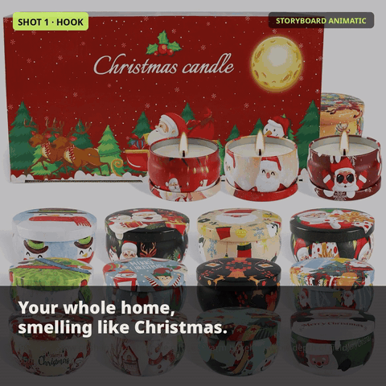

One product photo + one selling point → a four-shot director's prompt pack
(hook, product, proof, CTA) for Veo, Kling or Runway. The sample above is the
skill's storyboard for a real product — Halmiva's 16-piece candle set ($23) —
with each shot's prompt burned into the film.

**[Get the free skill →](https://skillux.dev/skills/product-ad-director)**

### UGC Seller Video — UGC that doesn't look AI-made

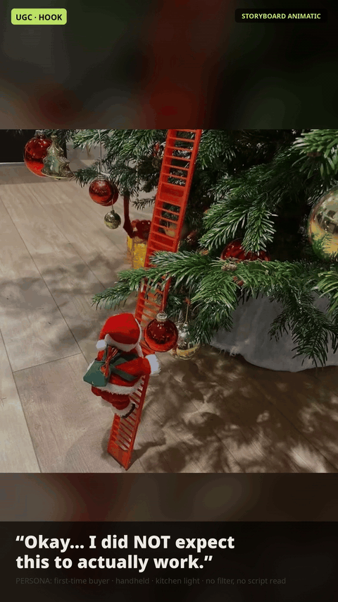

A buyer persona, lines written to be said out loud, and per-shot prompts with
handheld sway, exposure hunting and real-room clutter specified — because
"cinematic and perfect" is exactly what makes AI UGC fail. Sample product:
Climbing Ladder Santa ($21, Halmiva).

**[Get the free skill →](https://skillux.dev/skills/ugc-seller-video)**

### Brand Mood Film — palette-locked cinematic loops

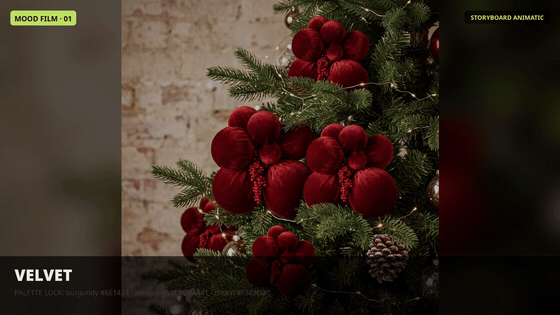

Locks three hex colours, one lens language and one lighting rule across every
shot prompt, so generated clips cut together as a single film — with a planned
loop point for hero backgrounds. Sample: Halmiva's Christmas collection,
burgundy / antique gold / cream.

**[Get the free skill →](https://skillux.dev/skills/brand-mood-film)**

### Remotion Product Demo — screenshots in, MP4 out

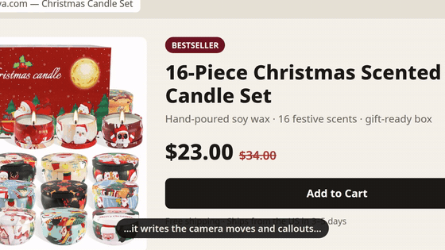

Writes a Remotion composition from your screenshots and copy — programmed
zooms, callouts timed to land after the zoom settles, captions and an end
card — then renders a finished demo. The full composition source ships inside
the pack.

**[Get the free skill →](https://skillux.dev/skills/remotion-product-demo)**

### Data Story Video — numbers that build themselves

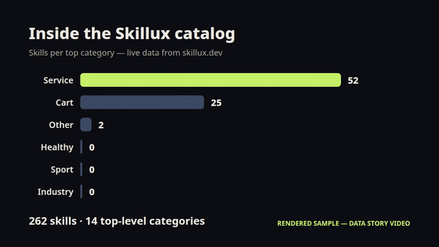

A CSV becomes a 30-second animated data story: one headline comparison, bars
in rank order, counters ticking, source held on screen. This sample is
rendered from live skillux.dev catalog data (262 skills by category).

**[Get the free skill →](https://skillux.dev/skills/data-story-video)**

---

## Showcase — Batch 02 (brand systems & store conversion)

### Brand Kit Video — your tokens, locked into every shot

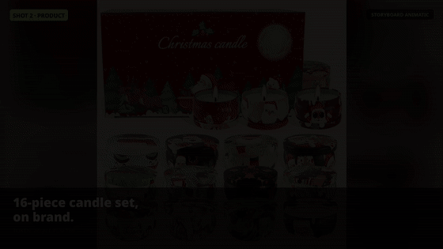

A brand kit (palette, fonts, layout, motion) becomes a token block repeated
verbatim in every shot prompt, plus a 6-point compliance check. The sample is
the skill's storyboard animatic with Skillux's own tokens — ink #EDEBE4, lime
#C8F169, dark #0E0F13 — locked into a Halmiva candle ad.

**[Get the free skill →](https://skillux.dev/skills/brand-kit-video)**

### Catalog to Video — a CSV in, one clip per product out

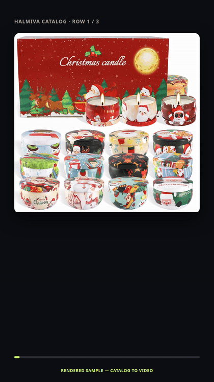

A Remotion batch renderer: each CSV row (photo, name, price, one selling
point) becomes the same 9:16 clip. The sample is a genuine render from a real
3-row Halmiva catalog — candle set $23, ornaments $21, climbing Santa $21.

**[Get the free skill →](https://skillux.dev/skills/catalog-to-video)**

### Price Drop Video — sale prices, announced automatically

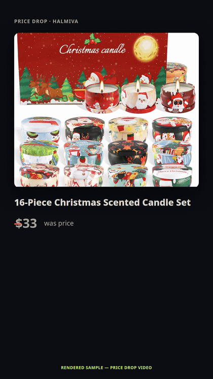

Feed the template a was/now pair and it renders the announcement: old price
struck through, new price big, one CTA. Sample: Halmiva's candle set,
$33 → $23, at the store's live prices.

**[Get the free skill →](https://skillux.dev/skills/price-drop-video)**

### Weekly Report Video — your week in numbers, rendered

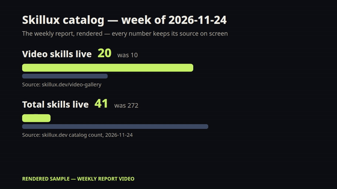

A metrics JSON becomes a 30-second KPI video — counters, bars, one takeaway,
and the source of every number kept on screen. The sample uses real Skillux
catalog numbers: video skills 10 → 20, total skills 272 → 282.

**[Get the free skill →](https://skillux.dev/skills/weekly-report-video)**

### Review to Video — verbatim, or not at all

One verified review becomes an animated quote-card video — the customer's
exact words, stars as earned, nothing invented. The sample runs the
template's no-review branch: Skillux opened reviews the same day and had no
real review to quote yet, so the card stays empty, on screen.

**[Get the free skill →](https://skillux.dev/skills/review-to-video)**

---

## Showcase — Batch 03 (new verticals & ecommerce scenes)

### Beauty Routine Video — a routine, locked to the brand

A three-step beauty routine — cleanse, serum, glow — directed shot by shot,
with the brand's type, palette and layout locked into every prompt. The sample
is the skill's storyboard animatic, scripted from a generic beauty brief.

**[Get the free skill →](https://skillux.dev/skills/beauty-routine-video)**

### Gift Guide Video — three gifts, one card each

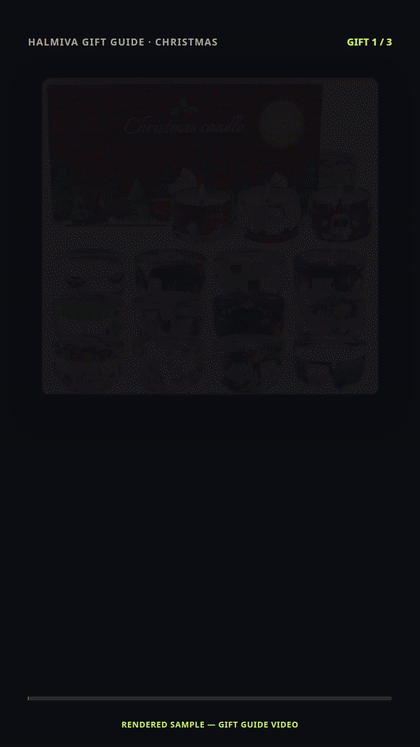

A gift list becomes a guided video: one card per product — photo, name, price,
one reason to give it. The sample is a genuine Remotion render for three real
Halmiva gifts with live prices checked 2026-11-25: candle set $23, ornaments
$21, stocking $10.

**[Get the free skill →](https://skillux.dev/skills/gift-guide-video)**

### Sale Countdown Video — a deadline that ticks

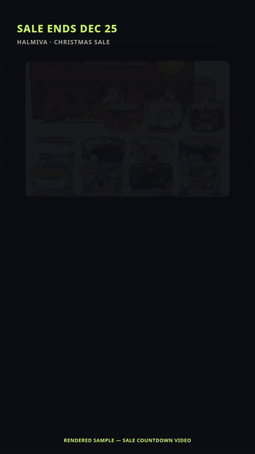

A sale deadline becomes a ticking clip: days, hours, minutes, seconds on
screen, old price struck through, new price big. The sample is a genuine
Remotion render for a real price drop — Halmiva's candle set, $33 → $23 —
counting down to a sample end date of Dec 25.

**[Get the free skill →](https://skillux.dev/skills/sale-countdown-video)**

### Livestream Clip Cutter — the hour, in three highlights

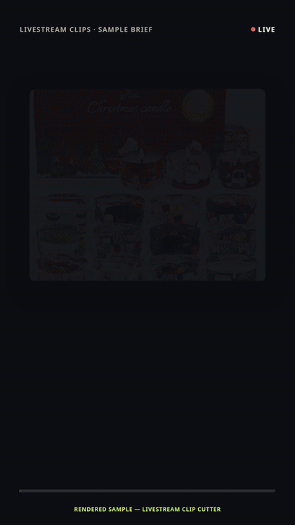

A long livestream becomes three vertical highlight clips: timestamp chip,
product shot, one subtitle line per card. The sample is a genuine Remotion
render built from a fictional sample stream brief — no real streamer, no real
stream data.

**[Get the free skill →](https://skillux.dev/skills/livestream-clip-cutter)**

### Before & After Video — proof without a fake photo pair

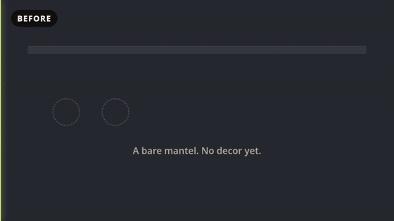

A split-screen wipe from a labelled illustrated "before" panel to the real
product photo — the honest way to do before/after with one photograph. The
sample is a genuine Remotion render, built from the composition inside the
pack.

**[Get the free skill →](https://skillux.dev/skills/before-after-video)**

---

## All thirty skills

| Skill | What it does | Get it |
|---|---|---|
| Product Ad Director | 15s AI video ad prompt pack from one product photo | [skillux.dev](https://skillux.dev/skills/product-ad-director) |
| UGC Seller Video | UGC scripts + prompts engineered to not look AI-made | [skillux.dev](https://skillux.dev/skills/ugc-seller-video) |
| Brand Mood Film | Palette-locked cinematic mood films and hero loops | [skillux.dev](https://skillux.dev/skills/brand-mood-film) |
| B-Roll Director | A B-roll prompt or stock brief for every script line | [skillux.dev](https://skillux.dev/skills/b-roll-director) |
| Remotion Product Demo | Screenshots + copy → rendered product demo MP4 | [skillux.dev](https://skillux.dev/skills/remotion-product-demo) |
| Data Story Video | Tables → animated data-story MP4s with Remotion | [skillux.dev](https://skillux.dev/skills/data-story-video) |
| Article to Video Cards | Articles → vertical card videos for Shorts/Reels | [skillux.dev](https://skillux.dev/skills/article-to-video) |
| Hook & Storyboard | 3 hooks + storyboard + animatic before you produce | [skillux.dev](https://skillux.dev/skills/hook-and-storyboard) |
| Script to Video | Scripts → captions, B-roll cues, teleprompter, edit list | [skillux.dev](https://skillux.dev/skills/script-to-video) |
| Shorts Script Writer | Long content → 60-second retention beat-map scripts | [skillux.dev](https://skillux.dev/skills/shorts-script-writer) |
| Brand Kit Video | Brand tokens locked into every shot prompt + compliance check | [skillux.dev](https://skillux.dev/skills/brand-kit-video) |
| Storefront Hero Video | Seamless homepage hero loops matched to your storefront | [skillux.dev](https://skillux.dev/skills/storefront-hero-video) |
| Unboxing Video | The 5-shot unboxing as a product-page conversion asset | [skillux.dev](https://skillux.dev/skills/unboxing-video) |
| Catalog to Video | CSV catalog → one rendered clip per product (Remotion) | [skillux.dev](https://skillux.dev/skills/catalog-to-video) |
| Price Drop Video | Was/now price pairs → rendered sale announcements | [skillux.dev](https://skillux.dev/skills/price-drop-video) |
| Weekly Report Video | Metrics JSON → 30-second KPI report video, sources on screen | [skillux.dev](https://skillux.dev/skills/weekly-report-video) |
| Review to Video | Verified reviews → quote-card videos, verbatim or not at all | [skillux.dev](https://skillux.dev/skills/review-to-video) |
| Launch Teaser Script | Launch teasers scripted + animatic before a frame is shot | [skillux.dev](https://skillux.dev/skills/launch-teaser-script) |
| How-To Script | Help docs → 60-second timed how-to video scripts | [skillux.dev](https://skillux.dev/skills/how-to-script) |
| Voiceover & Dub Script | Directed voice + EN/ES caption plans for one ad, two languages | [skillux.dev](https://skillux.dev/skills/voiceover-dub-script) |
| Beauty Routine Video | 3-step beauty routine, brand-locked shot by shot | [skillux.dev](https://skillux.dev/skills/beauty-routine-video) |
| Pet Product Video | 5-shot pet product ad, hook to CTA | [skillux.dev](https://skillux.dev/skills/pet-product-video) |
| Food Recipe Reel | Recipes → 20-second vertical Reels, one step per shot | [skillux.dev](https://skillux.dev/skills/food-recipe-reel) |
| Livestream Clip Cutter | Long streams → 3 captioned vertical highlight clips (Remotion) | [skillux.dev](https://skillux.dev/skills/livestream-clip-cutter) |
| Sale Countdown Video | Was/now prices + end date → ticking countdown clips (Remotion) | [skillux.dev](https://skillux.dev/skills/sale-countdown-video) |
| Before & After Video | Illustrated before → real product photo wipe (Remotion) | [skillux.dev](https://skillux.dev/skills/before-after-video) |
| Gift Guide Video | Gift lists → one guided video card per gift (Remotion) | [skillux.dev](https://skillux.dev/skills/gift-guide-video) |
| YouTube Long-Form Script | Topics → beat-mapped 8–12 minute scripts | [skillux.dev](https://skillux.dev/skills/youtube-longform-script) |
| Founder Story Script | Products → founder stories written from verifiable facts only | [skillux.dev](https://skillux.dev/skills/founder-story-script) |
| Ad Hook Test Script | One ad → 3 hook variants + A/B kill/scale plan | [skillux.dev](https://skillux.dev/skills/ad-hook-test-script) |

## Install

Each skill is a folder with a `SKILL.md` at its root. Download the free pack
from its Skillux page, unzip, and copy the folder into your agent's skills
directory:

- Claude Code: `~/.claude/skills/<skill-name>/`
- Codex: `~/.codex/skills/<skill-name>/`
- Cursor: `.cursor/skills/<skill-name>/` in your project

Then just ask for the task — the agent loads the skill when the request
matches. Sample storyboards, prompt tables and Remotion sources are included
in every pack.

## Why this exists

[Skillux](https://skillux.dev) publishes design and production skills for AI
coding agents. This repository collects the video batches — made with the
same rule the skills teach: show the finished thing, not a description of it.
The samples were produced with real store products from
[Halmiva](https://halmiva.com) and live catalog data from skillux.dev; where a
film is a storyboard animatic rather than a final AI render, it says so on the
film itself. Where a sample uses a generic brief instead of a real product
photo — the beauty, pet and food entries in batch 03 — the skill page says so.

## License

The skill packs are free to download and use from their Skillux pages.
Sample films © their respective workflow outputs; product images belong to
Halmiva.
